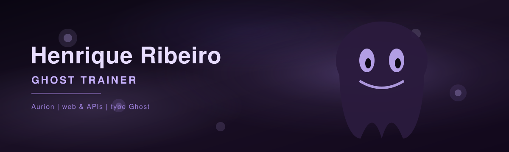

 

*Caçando bugs nas sombras — e saindo com o PR fechado.*

 

  

 

  
  &nbsp;&nbsp;
  <strong>Pokemon Party</strong>
  &nbsp;&nbsp;
  

 

&nbsp;&nbsp;

&nbsp;&nbsp;

&nbsp;&nbsp;

&nbsp;&nbsp;

&nbsp;&nbsp;

  

<code>Mimikyu</code>
&nbsp;·&nbsp;
<code>Marshadow</code>
&nbsp;·&nbsp;
<code>Gengar</code>
&nbsp;·&nbsp;
<code>Ceruledge</code>
&nbsp;·&nbsp;
<code>Hisuian Zoroark</code>
&nbsp;·&nbsp;
<code>Dragapult</code>

